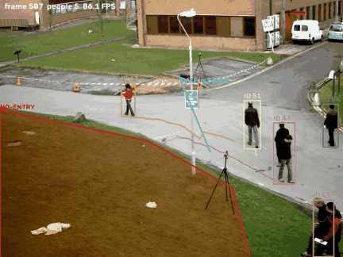
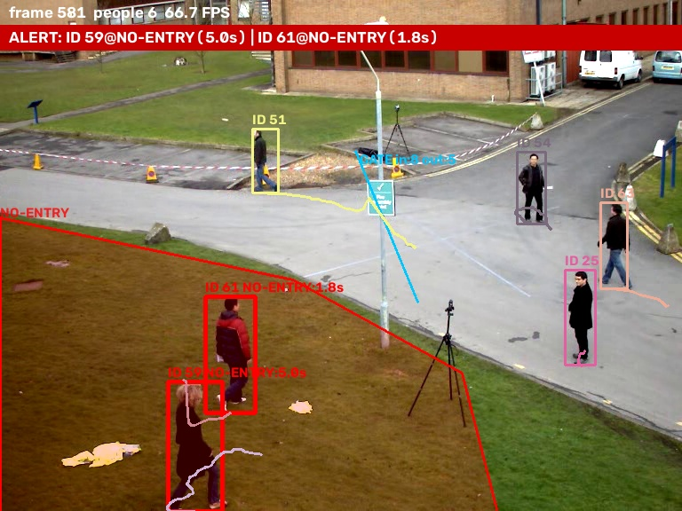
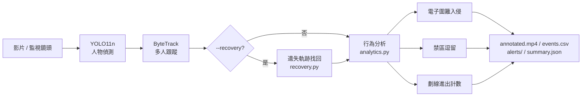
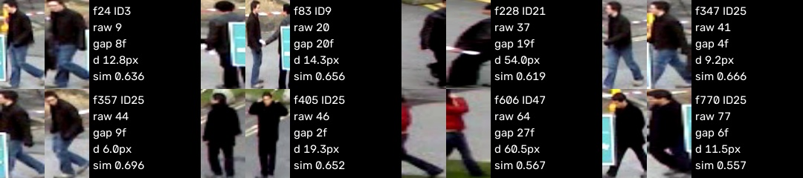

<div align="center">

# 人物跟蹤系統 Person Tracking System

**固定監視鏡頭下的多人跟蹤與危險區域入侵告警**

YOLO11n 人物偵測 → ByteTrack 多人跟蹤 → 電子圍籬入侵／禁區逗留／劃線進出計數




</div>

> 本專案為個人練習作品，題目參考市售「安全監控行為辨識」產品的應用情境（電子圍籬、人流計數、智慧工安），與任何廠商無關。

## 目錄

- [功能特色](#功能特色)
- [系統流程](#系統流程)
- [專案結構](#專案結構)
- [安裝](#安裝)
- [快速開始](#快速開始)
- [使用方式](#使用方式)
- [設定檔](#設定檔)
- [輸出檔案](#輸出檔案)
- [實驗結果](#實驗結果)
- [測試](#測試)
- [已知限制](#已知限制)
- [未來規劃](#未來規劃)
- [致謝](#致謝)
- [授權](#授權)

## 功能特色

- **電子圍籬入侵告警**：腳底中心點踏入禁區多邊形的當下（1 幀內）觸發，禁區內持續紅框並在畫面頂端顯示紅色 `ALERT` 橫幅
- **禁區逗留告警**：在禁區內連續停留超過 `loiter_sec` 秒觸發
- **劃線進出計數**：空間遲滯（`line_margin_px`）＋時間確認（`line_confirm_frames`），避免沿線行走或 ID 抖動造成重複計數
- **告警自動存證**：每次 `intrusion` / `loitering` 觸發時自動保存截圖
- **遺失軌跡找回**（`--recovery`）：以預測位置＋上衣/褲子 HSV 直方圖＋框高比對，把被遮擋後換了新 ID 的人接回原 ID
- **離線稽核工具**：不重跑 YOLO，直接以 `tracks.csv` 重播事件邏輯、掃描參數並輸出逐筆截圖
- **分析邏輯與模型解耦**：`analytics.py` 不依賴 YOLO，可單獨單元測試

<p align="center">
  <br>
  <sub>逗留告警存證截圖：ID 59 在 NO-ENTRY 區停留滿 5.0 秒</sub>
</p>

## 系統流程



判斷位置使用的是框的**腳底中心點**而非框中心，較貼近人實際站立的位置。

## 專案結構

```text
.
├── configs/
│   ├── vtest.json            # 禁區、計數線與防抖參數
│   └── trackers/             # ByteTrack / BoT-SORT 對照用設定
├── data/vtest.avi            # 測試影片（OpenCV 官方範例）
├── models/yolo11n.pt         # YOLO11n 權重
├── src/
│   ├── main.py               # 主程式：偵測 + 跟蹤 + 繪圖 + 事件輸出
│   ├── analytics.py          # 圍籬 / 逗留 / 劃線邏輯（與模型解耦）
│   ├── recovery.py           # 應用層遺失軌跡找回
│   ├── compare_trackers.py   # 追蹤器軌跡品質比較（handoff 代理指標）
│   ├── line_audit.py         # 劃線計數離線稽核
│   ├── zone_audit.py         # 禁區入侵離線稽核
│   └── side_by_side.py       # 兩段結果並排對照影片
├── tests/                    # pytest 單元測試
├── assets/                   # README 圖片
└── requirements.txt
```

## 安裝

需求：Python 3.12、NVIDIA GPU（CUDA 12.4，無 GPU 亦可用 CPU 執行但較慢）。

```bash
git clone https://github.com/yun193/person-tracking-system.git
cd person-tracking-system

python -m venv .venv
# Windows
.venv\Scripts\activate
# Linux / macOS
# source .venv/bin/activate

pip install torch==2.6.0 torchvision==0.21.0 --index-url https://download.pytorch.org/whl/cu124
pip install -r requirements.txt
```

## 快速開始

```bash
python src/main.py --source data/vtest.avi --config configs/vtest.json --out outputs/vtest --model models/yolo11n.pt --recovery
```

加上 `--show` 可即時顯示畫面（Esc 離開）。

## 使用方式

### 主程式 `src/main.py`

| 參數 | 預設 | 說明 |
|---|---|---|
| `--source` | （必填） | 影片路徑或 RTSP 串流網址 |
| `--config` | （必填） | 禁區／計數線設定檔（JSON） |
| `--out` | （必填） | 輸出資料夾 |
| `--model` | `yolo11n.pt` | YOLO 權重 |
| `--tracker` | `bytetrack.yaml` | 追蹤器設定，可換成 `botsort.yaml` 或 `configs/trackers/` 內的檔案 |
| `--conf` | `0.3` | 偵測信心門檻 |
| `--imgsz` | `640` | 推論影像尺寸 |
| `--recovery` | 關閉 | 啟用應用層遺失軌跡找回 |
| `--show` | 關閉 | 即時顯示畫面 |

### 離線稽核與比較工具

以下工具都直接讀取主程式輸出的 `tracks.csv`，不需重跑 YOLO。

```bash
# 劃線計數稽核：掃描遲滯 / 確認次數，輸出每次跨線前後截圖
python src/line_audit.py --run outputs/vtest --video data/vtest.avi --config configs/vtest.json --margins 0 10 --confirms 1 2 3 --gallery-margin 10

# 禁區入侵稽核：輸出每次入侵的前 / 當下 / 後截圖（intrusion_audit.jpg）
python src/zone_audit.py --run outputs/vtest --video data/vtest.avi --config configs/vtest.json

# 追蹤器軌跡品質比較
python src/compare_trackers.py outputs/cmp_bytetrack outputs/cmp_botsort outputs/cmp_botsort_reid
```

## 設定檔

`configs/vtest.json` 範例：

```json
{
  "lost_frames": 30,
  "exit_frames": 5,
  "line_margin_px": 10,
  "line_confirm_frames": 2,
  "zones": [
    { "name": "NO-ENTRY", "polygon": [[0, 245], [330, 315], [520, 420], [560, 580], [0, 580]], "loiter_sec": 5 }
  ],
  "lines": [
    { "name": "GATE", "a": [400, 170], "b": [470, 340] }
  ]
}
```

| 欄位 | 說明 |
|---|---|
| `zones` | 禁區多邊形（像素座標）與 `loiter_sec` 逗留門檻（秒） |
| `lines` | 計數線 `a`→`b`，人從線的左側走到右側算 `in` |
| `exit_frames` | 連續在禁區外幾幀才算離開（防止邊界抖動重複告警） |
| `line_margin_px` | 離計數線超過幾像素才算確定在某一側（防止沿線走時重複計數） |
| `line_confirm_frames` | 換到另一側要連續幾次才算跨線（防止 ID 接錯一幀造成一進一出） |
| `lost_frames` | 跟蹤遺失幾幀後清除狀態 |

> 禁區多邊形不要剛好壓在畫面邊緣（例如 576 高的影片底邊設成 `y=576`），射線法會把走到畫面底部的人誤判為離開，造成重複入侵告警；請略為超出畫面（如 `y=580`）。

## 輸出檔案

輸出於 `outputs/<名稱>/`：

| 檔案 | 內容 |
|---|---|
| `annotated.mp4` | 標註框、ID、軌跡、禁區、計數線與即時告警 |
| `events.csv` | 每筆事件：frame、秒數、類型（`intrusion` / `loitering` / `line_in` / `line_out`）、track_id、目標 |
| `tracks.csv` | 每幀每個軌跡的框座標，供離線稽核工具使用 |
| `alerts/` | 每次觸發 `intrusion` / `loitering` 的告警截圖（`<類型>_fXXXX_idXX.jpg`） |
| `summary.json` | 幀數、ID 數、平均 FPS、各線進出數、各類事件數 |
| `merges.csv`、`merges_gallery.jpg` | （`--recovery`）每次找回的紀錄與對照圖庫，供人工檢查是否接錯人 |

## 實驗結果

測試環境：RTX 3050 Ti Laptop 4GB，`vtest.avi`（768×576、10 FPS、795 幀），YOLO11n。
ByteTrack + 找回在此環境平均約 **74.8 FPS**（推論 13.4 ms/幀）。

> 影片沒有人工標註，以下 ID 數、handoff 等皆為**代理指標**，不是 MOTA / IDF1。

### 追蹤器對照

| 設定 | ID 數 | 疑似 ID 切換（handoff） | 平均軌跡秒數 | FPS |
|---|---|---|---|---|
| ByteTrack（預設） | 34 | 15 | 13.3 | 26.7 |
| BoT-SORT（不開 ReID，GMC 關閉） | 34 | 15 | 13.3 | 25.9 |
| BoT-SORT + ReID（auto） | 38 | 17 | 11.9 | 23.3 |
| ByteTrack，track_buffer 60 | 34 | 14 | 13.3 | 26.0 |
| ByteTrack，conf 0.1 | 34 | 14 | 13.4 | 25.3 |
| ByteTrack，conf 0.1、imgsz 960 | 45 | 21 | 10.6 | 24.8 |

結論：ByteTrack 維持預設。

- ultralytics 的 BoT-SORT 只在 IoU ≥ 0.5（`proximity_thresh`）時才參考外觀特徵；人被遮擋後再出現時已經移動，IoU 過不了門檻，ReID 派不上用場
- auto 模式使用 YOLO 骨幹特徵，在 50–80px 的小人框上鑑別力不足，反而讓 ID 數增加
- 15 次切換中有 9 次間隔 ≤ 1 秒、全部都在 `track_buffer` 內，問題出在關聯門檻而非緩衝長度

### 遺失軌跡找回（`--recovery`）

追蹤器給出新 ID 時，`src/recovery.py` 會在剛消失（3 秒內）的人裡找最像的接回去：

1. **位置閘門**：用消失前的速度預測現在位置，半徑隨消失時間放寬（40px + 8px/幀）
2. **框高**：新舊框高度比 ≤ 1.6
3. **外觀**：上衣、褲子各一個 HSV 直方圖；上衣相似度 < 0.47 直接排除，平均 ≥ 0.55 才接
4. **收回**：若追蹤器之後自己把原軌跡接回來（同一幀出現兩個相同 ID），較早的保留、後接的拆回自己的 ID
5. 與別人重疊時不更新外觀，避免被別人的衣服污染

| 設定 | ID 數 | 疑似 ID 切換 | 重複 ID 幀 | 平均軌跡秒數 |
|---|---|---|---|---|
| ByteTrack | 34 | 15 | 0 | 13.3 |
| BoT-SORT + ReID | 38 | 17 | 0 | 11.9 |
| **ByteTrack + 找回** | **28** | **10** | 0 | **16.1** |

<p align="center">
  <br>
  <sub>找回圖庫：左為消失前、右為新出現，用於人工確認是否接錯人</sub>
</p>

> handoff 指標與找回使用類似的「時間＋距離」條件，數字下降有一部分是方法本身決定的，正確與否以圖庫人工檢查為準。

### 劃線計數稽核

| 設定 | ByteTrack（in/out） | ByteTrack + 找回（in/out） |
|---|---|---|
| 舊版（純線段相交） | 12/8 | 14/9 |
| 遲滯 10px、確認 2 次（目前預設） | 12/8 | 13/8 |

- 舊版多算的：沿線行走、在線附近來回（一進一出），以及 ID 接錯一幀又收回造成的一進一出
- 確認次數 3 太嚴：剛跨線就被遮擋的人會漏算
- 兩者仍差的 1 次：有人在燈柱後被擋住時跨線，ByteTrack 斷成兩個 ID 而漏算，找回將其接起
- **場景建議**：計數線目前畫在燈柱上，正是最容易遮擋的位置；將線左右平移 80px 後兩種方式結果完全一致

### 危險區域入侵稽核

`vtest.avi` 草地 `NO-ENTRY` 逐筆核對（共 6 筆入侵＋1 筆逗留）：

- **即時觸發**：真正走進草地的人（ID 53、59、71）都在腳底跨入禁區當下（1 幀內，約 0.1 秒）觸發紅框、橫幅與截圖存證
- **逗留**：ID 59 停留滿 5.0 秒（53.1s → 58.1s）準確觸發逗留告警
- **修正的邊界 Bug**：多邊形底邊原設 `y=576`（剛好壓在畫面底緣），ID 59 走到畫面底部時被判為離開又再次入侵；改為 `y=580` 後重複入侵消除（7 → 6 筆），連續在區內 217 幀無中斷

## 測試

```bash
python -m pytest -q tests
```

涵蓋 `analytics.py`（圍籬、逗留、劃線、邊界抖動）與 `recovery.py`（找回、同幀重複 ID 收回）。

## 已知限制

1. **人對人嚴重遮擋**：ID 53 與 ID 59 在草地內重疊後，ID 53 僅露上半身（框高減半），超出找回門檻 `max_height_ratio=1.6`，切出新 ID 61 並多報 1 次入侵
2. **擦邊告警**：ID 1（0.0s）、ID 47（60.6s）腳底貼著草地邊緣 3–6 幀即觸發；若不希望擦邊告警，可將多邊形內縮或加上進入確認幀數
3. **外觀特徵有限**：找回適合短時間遮擋（≤ 3 秒）且衣著有區別的場景；遇到穿同色衣服交錯或光線劇烈變化，需升級為專用 ReID 模型（如 OSNet）
4. **門檻樣本少**：上衣相似度門檻 0.47 是以 vtest 的 7 筆找回校正，換場景需重新校正

## 未來規劃

- [ ] 計數線移離燈柱（遮擋處）
- [ ] 互動式禁區／計數線繪製工具（滑鼠點選產生 config）
- [ ] 跌倒、奔跑等行為判斷
- [ ] 專用 ReID 模型（OSNet）取代色彩直方圖

## 致謝

- [Ultralytics YOLO](https://github.com/ultralytics/ultralytics)：人物偵測與 ByteTrack / BoT-SORT 追蹤器實作
- [ByteTrack](https://github.com/ifzhang/ByteTrack)：多目標追蹤演算法
- [OpenCV](https://github.com/opencv/opencv)：測試影片 `vtest.avi` 取自 OpenCV 官方範例資料

## 授權

本專案尚未指定授權條款。請注意所依賴的 Ultralytics YOLO 採用 [AGPL-3.0](https://github.com/ultralytics/ultralytics/blob/main/LICENSE) 授權，`yolo11n.pt` 權重亦受其規範。
